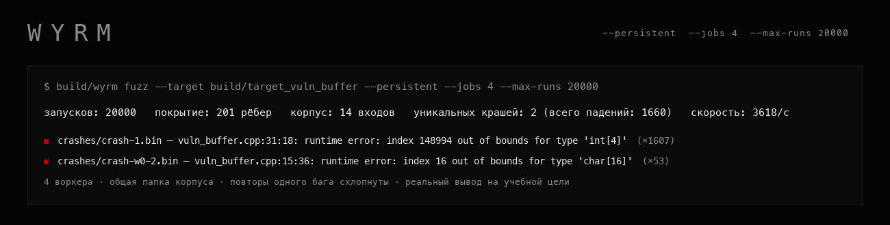

<div align="center">



**Coverage-guided фаззер в духе AFL.**
Мутирует входные данные, следит за покрытием кода через shared-memory карту и сохраняет всё, что роняет цель под ASan/UBSan.

  

</div>

## Зачем это

Фаззинг — один из немногих способов находить баги памяти (переполнения, выходы за границы, деление на ноль, UB), которые статический анализ и ручной ревью пропускают. `wyrm` — учебная реализация идеи AFL: не претендует на производительность настоящего AFL++/libFuzzer, но показывает всю механику изнутри — инструментацию покрытия, мутации, обратную связь по рёбрам графа потока управления, минимизацию крашей, persistent-режим и параллельных воркеров.

<div align="center">

<sub>настоящий прогон на учебной цели <code>vuln_buffer</code>: 20 000 запусков, 4 воркера, режим persistent</sub>
</div>

## Быстрый старт

```bash
make                    # собрать wyrm и учебные цели (clang++, ASan+UBSan+coverage)
make test               # модульные и сквозные тесты (долго: настоящий фаззинг целей, около 8 минут)

build/wyrm fuzz --target build/target_vuln_buffer --corpus corpus --seed-dir corpus_seeds/vuln_buffer --max-runs 200000
build/wyrm fuzz --target build/target_json_lite --corpus corpus --seed-dir corpus_seeds/json_lite --persistent --jobs 4 --max-seconds 60
build/wyrm replay --target build/target_vuln_buffer --input crashes/crash-1.bin
build/wyrm minimize --target build/target_vuln_buffer --input crashes/crash-1.bin --output min.bin
```

| флаг | что делает |
| :-- | :-- |
| `--persistent` | один долгоживущий процесс цели вместо `fork`+`exec` на каждый вход |
| `--persistent-iterations N` | через сколько входов процесс цели заменяется новым (по умолчанию 2000) |
| `--jobs N` | N параллельных воркеров с общей папкой корпуса |
| `--max-runs N`, `--max-seconds N` | остановиться после N запусков или секунд |
| `--timeout N` | таймаут одного запуска (по умолчанию 2 с) |
| `--seed N` | сид генератора, для воспроизводимых прогонов |

Собрано и проверено на clang под macOS (Apple Silicon). Сборка через CMake тоже описана (`CMakeLists.txt`), но в CI проверяется только `make`.

## Как это работает

1. **Инструментация.** Цели собираются с `-fsanitize-coverage=trace-pc-guard`: компилятор вставляет вызов на каждом переходе между базовыми блоками. Среда выполнения (`coverage_rt.cpp`) при каждом вызове отмечает байт в карте покрытия — общей памяти между фаззером и целью.
2. **Мутации.** Побитовые/побайтовые флипы, арифметика, «интересные» граничные константы (-1, 0, 128, MAX_INT...), вставка/удаление кусков, сращивание двух входов из корпуса — набор в духе havoc-режима AFL.
3. **Обратная связь.** После каждого запуска фаззер проверяет, появились ли новые ненулевые байты в карте покрытия. Если да — вход достиг кода, которого раньше не видели, и остаётся в корпусе.
4. **Обнаружение крашей.** Цели собраны с ASan и UBSan. Падение (SIGSEGV/SIGABRT, код выхода санитайзера) сохраняется в `crashes/` вместе с текстом отчёта.
5. **Минимизация.** Delta-debugging (бинарный разрез входа) плюс побайтовое обнуление сводят краш-инпут к минимальному воспроизводимому PoC.

### Режимы запуска цели

- **По умолчанию:** каждый вход запускается отдельным процессом (`fork`+`exec`) с таймаутом и перехватом stderr. Просто и надёжно, но медленно.
- **`--persistent`:** цель реализует `LLVMFuzzerTestOneInput`, а `persistent_rt.cpp` даёт ей `main()`. Вход попадает в процесс через общую память, команда «выполни» идёт по каналу, готовность возвращается по другому. Процесс живёт, пока не упадёт, не зависнет или не выработает `--persistent-iterations`: тогда его заменяют новым. Если цель упала, фаззер забирает код сигнала и отчёт санитайзера из временного файла, а следующий вход уходит в свежий процесс.
- **Проверка крашей.** Состояние между входами в одном процессе не сбрасывается, поэтому падение могло зависеть от предыдущих входов. Каждый краш из persistent-режима перепроверяется в чистом процессе, и если он не повторился, файл остаётся, но в отчёте помечен «не воспроизводится в чистом процессе». Для проверки есть учебная цель `stateful`, которая падает на седьмом вызове в одном процессе независимо от входа.
- **`--jobs N`:** N процессов-воркеров (не потоков: `fork`+`exec` из многопоточной программы небезопасен). У каждого своя карта покрытия, общая папка корпуса: воркер пишет свои входы файлами с префиксом `wN-` (через временный файл и `rename`, чтобы другие не прочитали недописанное) и раз в секунду подбирает чужие, как режимы `-M/-S` у AFL. Начальные сиды кладёт один процесс до старта воркеров, итоги воркеров собираются в один отчёт.


## Учебные цели

В `targets/` четыре маленькие программы с намеренными багами — полигон, чтобы показать, что фаззер реально находит:

| цель | баг |
| :-- | :-- |
| `parse_header` | переполнение буфера: длина поля не проверяется против размера `name[64]` |
| `vuln_buffer` | три бага за байтом-переключателем: переполнение стека, деление на ноль, выход за границы массива |
| `json_lite` | неограниченная рекурсия в разборе вложенности — переполнение стека на глубоком вводе |
| `stateful` | падает на седьмом вызове в одном процессе независимо от входа (ловушка для persistent-режима); вход, начинающийся с `H`, зависает |

Это учебные программы, а не уязвимости чужого ПО. Баги в них оставлены специально: не используй эти цели вне полигона и не запускай их на машине с важными данными.

## Реальный прогон

Настоящий вывод `wyrm fuzz` на `target_vuln_buffer`, 4000 запусков, режим по умолчанию. Затравки есть только у двух из трёх багов (переполнение и выход за границы; деление на ноль намеренно не засеяно):

```
запусков: 4000   покрытие: 190 рёбер   корпус: 5 входов   уникальных крашей: 2 (всего падений: 401)   скорость: 100/с
  ▓ crashes/crash-1.bin — vuln_buffer.cpp:31:18: runtime error: index 148994 out of bounds for type 'int[4]'  (×393)
  ▓ crashes/crash-2.bin — vuln_buffer.cpp:15:36: runtime error: index 16 out of bounds for type 'char[16]'  (×8)
```

Из 401 падения получилось две записи: повторы одного места в коде схлопываются по сигнатуре (причина и верхний кадр стека без адресов и конкретных индексов), файл сохраняется один, а число повторов видно в скобках. Раньше каждое падение давало свой файл.

Любопытный и честный результат: третий баг, деление на ноль, за эти 4000 запусков не нашёлся, хотя его затравка была в корпусе. Ему нужно попадание байта ровно в значение 42, а слепые битфлипы и арифметика с шагом ±35 такое почти не угадывают. Это типичное слабое место havoc-мутаций без знания о сравнениях в коде цели (на это рассчитан CMPLOG в AFL++, в `wyrm` его нет).

Минимизация одного из найденных крашей: `7 → 6 байт`, итог `52 00 00 00 00 ff`, то есть один байт `'R'` и мусор, задающий индекс вне диапазона.

## Скорость режимов

Один и тот же прогон `json_lite`, 3000 запусков, один воркер, одинаковый сид (на ноутбуке с M5, пока параллельно шли тесты, так что цифры занижены):

| режим | скорость | покрытие | корпус |
| :-- | :-- | :-- | :-- |
| `fork`+`exec` на вход | 86/с | 170 рёбер | 27 входов |
| `--persistent` | 22 423/с | 170 рёбер | 27 входов |

Разница примерно в 260 раз при том же покрытии и корпусе.

На `vuln_buffer`, где около 10% входов роняют цель, выигрыш скромнее, потому что каждое падение означает перезапуск процесса: 4000 запусков в режиме по умолчанию шли со скоростью 100/с, а 20 000 запусков с `--persistent --jobs 4` со скоростью 3618/с (1660 падений, из них 2 уникальных).

## Как проверялось

- 39 тестов: мутатор (детерминизм по сиду, границы размера, splice), корпус (сохранение, восстановление, продолжение нумерации, обмен между воркерами, игнорирование недописанных файлов), карта покрытия, минимизатор на синтетическом предикате, дедупликация крашей (сигнатура не зависит от адресов и индексов, но различает места ошибки; повторы схлопываются в одну запись и один файл).
- Persistent-режим: процесс живёт между входами, покрытие сбрасывается между запусками, краш и таймаут не ломают следующий запуск, плановая замена процесса, вход больше общей памяти уходит обычным запуском, понятная ошибка при несуществующей цели, ASan-вывод прошлых входов не попадает в отчёт следующего краша, краш от накопленного состояния помечается невоспроизводимым.
- Параллельный режим: два воркера находят баги и делят бюджет запусков, остановка снаружи завершает всех, ошибка воркера возвращается исключением, а не зависанием.
- Сквозные тесты реально компилируют и фаззят учебные цели как подпроцессы и проверяют, что баги находятся: переполнение в `parse_header`, минимум 2 из 3 багов в `vuln_buffer` за ограниченный бюджет запусков, минимизация реального краша до компактного PoC.
- При первом прогоне первых 19 тестов 2 падали не из-за логики фаззера, а из-за настройки целей: на этой связке Apple clang 21 (arm64) `-O1` не всегда расставляет redzone вокруг стековых буферов, и переполнение проходило мимо ASan — помогло только `-O0`. Отдельно UBSan по умолчанию печатает диагностику и **продолжает выполнение** вместо падения — нужен `-fno-sanitize-recover=all`. Проверил оба случая отдельным минимальным репро, прежде чем менять флаги.
- Полный прогон тестов на Apple Silicon занимает около 8 минут: сквозные тесты честно фаззят цели в режиме `fork`+`exec`, а он медленный.
- В CI на каждый коммит: сборка и тесты на Ubuntu (macOS проверяется локально, раннеры macOS слишком дороги по минутам), отдельная сборка с `-Werror`, `clang-tidy` как справочная проверка.

## Ограничения

- **Режим по умолчанию медленный.** Процесс на запуск даёт около сотни запусков в секунду. Persistent-режим быстрее на порядки, но требует цели с `LLVMFuzzerTestOneInput`, чистой по отношению к своим глобальным данным; произвольную программу с собственным `main()` можно фаззить только в режиме по умолчанию.
- **Persistent не использует `fork`-сервер AFL**: упавший процесс просто заменяется новым, а не форкается из прогретого.
- **Воркеры синхронизируются через файлы** раз в секунду, без общей карты покрытия: возможна небольшая избыточная работа.
- **Сборка проверена только на clang.** Linux проверяется в CI, но у меня локально проверено лишь macOS.
- **Карта покрытия 64 КБ без разрешения коллизий** — как у классического AFL, на крупных целях возможны редкие совпадения хэшей рёбер.
- **Нет планировщика по энергии/приоритету** входов: выбор из корпуса равномерно случайный, а не по «интересности» входа.

## Лицензия

MIT, см. [LICENSE](LICENSE).
